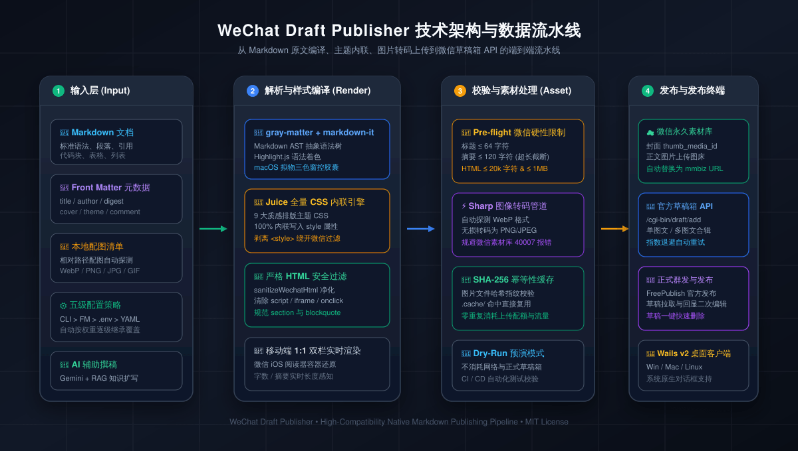
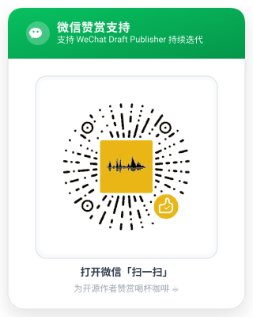

# FlowDraft - 新媒体排版与自动化发布工作台 (WeChat Draft Publisher)

<p align="center">
  
</p>

<p align="center">
  <b>全能型新媒体排版与自动化发布工作台 · 微信原生 SVG 动效 · 小绿书 3:4 切图 · 封面与商用图库 · 热点雷达 · 草稿箱推送与全域矩阵协同</b>
</p>

<p align="center">
  <a href="https://opensource.org/licenses/MIT"></a>
  <a href="https://github.com/sponsors"></a>
  
  
  
  
  
</p>

---

## 🌟 核心亮点

- ✍️ **实时双栏可视化工作台**：左侧 Markdown 编辑与 Front Matter 智能提取，右侧 1:1 还原真实 iPhone 微信公众号手机阅读外观。
- 🎨 **9 款高质感微信排版主题**：参考业内标杆排版规范，内置极客红、暖心橙、极客湛蓝、素雅黑白、青金石蓝等 9 套精美主题，支持一键独立开启/关闭主题排版。
- 🖼️ **高清长图渲染导出 (Poster / 长微博)**：一键将整篇排版文章光栅化渲染为超清长图（PNG / JPG），提供微信仿真移动端、长微博、卡片海报 3 种版式，支持 2x / 3x Retina 视网膜高清分辨率；内置全图自适应（Fit Screen）预览、适合宽度与自由缩放（10% ~ 200%），支持一键复制到剪贴板或下载。
- 📥 **微信线上文章一键逆向提取**：输入任意公开微信公众号推文链接，智能提取正文与素材并逆向清洗为干净排版的 Markdown，自动去除冗余广告与微信底层容器，支持一键载入主编辑器修改或加入多图文。
- 📑 **可视化多图文拖拽编排**：直观的多图文合辑编排界面，支持拖拽调序、独立配置每篇封面、作者、摘要与主题，最多支持 8 篇图文合并推送到微信草稿箱。
- 🌐 **多平台内容矩阵分发**：一键将当前 Markdown 与排版成果转换为适配知乎 (Zhihu Markdown / HTML)、掘金、CSDN、小红书贴文等平台的内容格式，一处编写全网分发。
- 🎨 **自定义 CSS 与主题设计器**：可视化微调主色调、字号、字距、行高、代码块配色与圆角，支持编写自定义 CSS 规则并全量 Juice 内联编译，可持久化保存为专属预设。
- 📁 **本地文件夹自动监听与持续发布 (Watch Mode)**：本地监控指定 Markdown 目录，文件保存时自动执行样式编译并热同步到草稿箱。
- 🗃️ **微信素材库管理与 MediaID 直接复用**：实时浏览公众号永久素材库中的已有图片，支持一键复用已有 `thumb_media_id` 为当前文章封面（免重复上传消耗配额），或一键插入 Markdown。
- ⏱️ **本地多版本快照与时间线历史回退**：自动定时与发布里程碑防误删快照备份，支持时间线版本对比、恢复与删除，不怕丢稿。
- 📐 **LaTeX / KaTeX 数学公式与 Mermaid 流程图**：彻底解决微信公众号不支持原生 LaTeX 的痛点，完美支持行内公式 `$E=mc^2$` 与块级公式，支持 Mermaid 图表生成。
- 🖼️ **全自动配图流水线与智能压缩**：自动解析 Markdown 中的相对路径配图，支持 PNG / JPG / GIF / WebP；**内置 Sharp 图像处理管道**与前端智能压缩，WebP 格式自动无损转码为微信素材库原生兼容格式，自带 SHA-256 哈希缓存去重。
- 🤖 **通用 AI 文章创作引擎 (Multi-LLM, Human-in-the-Loop)**：内置 **DeepSeek / 通义千问 / Kimi / OpenAI / 智谱 GLM / Gemini** 及任意 OpenAI 兼容接口（**Ollama / vLLM**）；按受众与风格一键生成带 Front Matter 的规范文章，支持导入本地参考文档。
- 📦 **草稿箱管理与正式群发 (FreePublish)**：直连微信官方草稿箱接口，拉取查看历史草稿、一键回显修改，支持直接触发微信 FreePublish 免审群发。
- 🛡️ **全方位微信规格前置校验 (Pre-flight Check)**：严格校验微信公众号技术指标（标题 ≤64 字、作者 ≤16 字、摘要 ≤120 字、正文 HTML ≤20,000 字符且 ≤1MB），前置拦截超标内容。
- 🧩 **微信爆款排版组件物料库**：内置 18+ 款高转化视觉内联组件（渐变微光金句框、微信对话仿真气泡、三步流程卡、折叠答疑、播客试听条、互动投票表决卡、Mac 终端代码框等），100% 微信富文本内联排版，跨移动端与桌面端零样式丢失。
- 🎨 **微信公众号封面图设计工坊**：2.35:1 官方大封面 (940×400)、1:1 正方形图 (600×600)、3:4 长图全尺寸支持，带微信官方安全区辅助线（朋友圈 1:1 核心防截断区）与 8 套大厂设计模板，支持一键应用或导出。
- 🏷️ **爆款标题实验室与微信截断诊断**：实时模拟订阅号常读流、微信群转发卡片、朋友圈三端卡片视觉截断，深度诊断字数、数字量化、利益钩子与广告法风险，提供 6 大经典体系爆款标题智能派生。
- ⚡ **全局指令面板与极速调度 (Cmd+K / Ctrl+K)**：类似现代顶级开发者工具的全局 Command Palette，全键盘极速检索并触发发布、主题、封面、物料、合规体检与视图切换。
- 📅 **运营日历与发文资产档案管理**：月度甘特排期、发文资产自动归档沉淀、矩阵账号分发概览与 CSV / JSON 报表一键导出。
- 🪄 **微信原生 SVG 交互黑科技工坊**：点击展开答案彩蛋、手势全景横滑图集、黑胶唱盘匀速旋转播客条、全景弹幕滚动墙等 8 款原生交互动效，100% 微信富文本内联渲染，无需外部 JS。
- 🖼️ **免版权高清商用图库即搜即用**：打通 Unsplash 商业免版权高清图库，支持按科技/职场/极简/风景及 16:9 / 2.35:1 / 1:1 / 3:4 比例检索，一键圆角/阴影/图注美化容器或设为大封面。
- 📱 **微信「小绿书模式」九宫格图文卡片工坊**：文章一键智能分片为 1~9 张 3:4 (1080×1440) 精美轮播卡片，6 款官方高级设计主题，支持单卡精修、九宫格矩阵总览、Retina 高清 PNG 批量导出与草稿直发。
- 💻 **双模高效运行**：既支持在浏览器中享受富交互可视化排版（Web），也提供极速命令行批处理工具（CLI），轻松接入 CI/CD 流水线。

---

## 目录

- [一、快速从零上手指引](#一快速从零上手指引)
  - [1.1 准备环境与安装](#11-准备环境与安装)
  - [1.2 获取并配置微信公众号开发者凭据](#12-获取并配置微信公众号开发者凭据)
  - [1.3 启动 Web 可视化排版工作台](#13-启动-web-可视化排版工作台)
  - [1.4 写作与一键发布流程详解](#14-写作与一键发布流程详解)
- [二、核心功能全景介绍](#二核心功能全景介绍)
  - [2.1 九大内置排版主题与开关](#21-九大内置排版主题与开关)
  - [2.2 通用 AI 文章创作引擎（多模型支持）与本地资料导入](#22-通用-ai-文章创作引擎多模型支持与本地资料导入)
  - [2.3 草稿箱管理与多图文合并推送](#23-草稿箱管理与多图文合并推送)
  - [2.4 本地配图解析与 WebP 自动转码](#24-本地配图解析与-webp-自动转码)
  - [2.5 微信线上文章一键逆向提取](#25-微信线上文章一键逆向提取)
  - [2.6 高清长图渲染导出 (Poster / 长微博 / 卡片海报)](#26-高清长图渲染导出-poster--长微博--卡片海报)
  - [2.7 可视化多图文拖拽编排中心](#27-可视化多图文拖拽编排中心)
  - [2.8 多平台内容矩阵分发扩展 (Multi-Platform Matrix Distribution Expansion)](#28-多平台内容矩阵分发扩展-multi-platform-matrix-distribution-expansion)
  - [2.9 自定义 CSS 与主题设计器](#29-自定义-css-与主题设计器)
  - [2.10 本地文件夹自动监听与持续发布 (Watch Mode)](#210-本地文件夹自动监听与持续发布-watch-mode)
  - [2.11 微信素材库管理与已有 MediaID 直接复用](#211-微信素材库管理与已有-mediaid-直接复用)
  - [2.12 本地多版本快照与时间线历史回退](#212-本地多版本快照与时间线历史回退)
  - [2.13 LaTeX 数学公式与 Mermaid 流程图渲染](#213-latex-数学公式与-mermaid-流程图渲染)
  - [2.14 编辑器沉浸体验与排版效能增强 (Zen Focus Mode & Typography)](#214-编辑器沉浸体验与排版效能增强-zen-focus-mode--typography)
  - [2.15 多账号矩阵管理与发布合规安全体检 (Multi-Account Matrix & Safety Guard)](#215-多账号矩阵管理与发布合规安全体检-multi-account-matrix--safety-guard)
  - [2.16 微信爆款排版组件物料库 (Interactive Components & Material Library)](#216-微信爆款排版组件物料库-interactive-components--material-library)
  - [2.17 微信公众号封面图设计工坊 (Cover Designer Studio)](#217-微信公众号封面图设计工坊-cover-designer-studio)
  - [2.18 爆款标题实验室与微信列表截断诊断 (Headline Lab & WeChat Feed Truncation Diagnostic)](#218-爆款标题实验室与微信列表截断诊断-headline-lab--wechat-feed-truncation-diagnostic)
  - [2.19 全局指令面板与极速动作调度 (Command Palette Cmd+K)](#219-全局指令面板与极速动作调度-command-palette-cmdk)
  - [2.20 运营日历与发文资产档案管理 (Editorial Calendar & Article Asset Archive)](#220-运营日历与发文资产档案管理-editorial-calendar--article-asset-archive)
  - [2.21 微信原生 SVG 交互黑科技排版工坊 (SVG Interactive Canvas)](#221-微信原生-svg-交互黑科技排版工坊-svg-interactive-canvas)
  - [2.22 免版权高清商用图库集成与智能配图流水线 (Royalty-free Stock & Workflow)](#222-免版权高清商用图库集成与智能配图流水线-royalty-free-stock--workflow)
  - [2.23 微信「小绿书模式」专属九宫格图文卡片切图工坊 (WeChat Image-Text Note)](#223-微信小绿书模式专属九宫格图文卡片切图工坊-wechat-image-text-note)
- [三、命令行使用指南 (CLI)](#三命令行使用指南-cli)
- [四、Markdown 与 Front Matter 规范](#四markdown-与-front-matter-规范)
- [五、技术架构与五级配置机制](#五技术架构与五级配置机制)
- [六、Wails v2 桌面客户端打包与发布](#六wails-v2-桌面客户端打包与发布)
- [七、常见排错与微信官方错误码速查](#七常见排错与微信官方错误码速查)
- [八、赞助与打赏支持 (Sponsor)](#八赞助与打赏支持-sponsor)
- [九、开源协议 (License)](#九开源协议-license)

---

## 一、快速从零上手指引

### 1.1 准备环境与安装

本项目要求 **Node.js ≥ 18.0.0**，推荐使用 `pnpm` 进行依赖包管理（亦完全兼容 `npm`、`yarn`、`bun`）：

```bash
# 1. 克隆本仓库到本地
git clone https://github.com/andrewlaredo/wechat-draft-publisher.git
cd wechat-draft-publisher

# 2. 安装项目依赖 (推荐 pnpm)
pnpm install
```

### 1.2 获取并配置微信公众号开发者凭据

1. 登录 [微信公众平台 (mp.weixin.qq.com)](https://mp.weixin.qq.com/)；
2. 进入左侧菜单 **「设置与开发」** ➡️ **「基本配置」**：
   - 复制 **开发者ID (AppID)**；
   - 生成并保管好 **开发者密码 (AppSecret)**；
   - **至关重要的一步**：在 **「IP 白名单」** 设置中，将您运行本程序的机器的公网出口 IP 加入白名单（若在本地运行，可通过百度或 Google 搜索“我的 IP”查询）；
3. 配置凭据（以下两种方式任选一种）：
   - **方式一（Web 界面录入）**：直接启动程序后，在网页顶栏点击「凭据配置」直接输入保存；
   - **方式二（文件配置）**：复制环境变量文件并在 `.env` 中填写：
     ```bash
     cp .env.example .env
     ```
     编辑 `.env`：
     ```env
     WECHAT_APP_ID=wx1234567890abcdef
     WECHAT_APP_SECRET=0123456789abcdef0123456789abcdef
     ```

### 1.3 启动 Web 可视化排版工作台

执行以下命令即可启动可视化开发服务：

```bash
pnpm dev
```

终端将输出访问地址，打开浏览器访问：
```
http://localhost:3000
```

### 1.4 写作与一键发布流程详解

```
 ┌─────────────────┐       ┌─────────────────┐       ┌─────────────────┐
 │ 1. 左栏编写文章  │ ────> │ 2. 右栏实时预览  │ ────> │ 3. 一键推送发布  │
 │ Markdown + YAML │       │ 选主题/贴图/移动端│      │ 试运行 / 正式推送│
 └─────────────────┘       └─────────────────┘       └─────────────────┘
```

1. **选择模式与模板**：
   - 顶栏左侧可随时切换「图文长文」或「图片贴图（小绿书模式）」；
   - 下拉菜单可选择预置的多篇精选行业模板，快速上手；
2. **编辑正文与配图**：
   - 在左侧编写标准 Markdown，可使用工具栏快速插入标题、粗体、代码块或图片语法；
   - 在「文章元数据」面板中设定文章标题、作者名、摘要（自动防超 120 字截断）以及封面图路径；
3. **实时排版与主题调试**：
   - 在工具栏中选择心仪的排版主题（如极客红、极客湛蓝、暖纸人文等）；
   - 切换「Mac 风格代码」开关，代码块上方自动带有一体化红黄绿三色控制圆点；
   - 若您偏好原生黑白排版，可一键关闭「主题排版」总开关；
4. **一键发布**：
   - **试运行 (Dry-Run)**：建议首次发布前点击顶栏「试运行」，系统将在本地执行完整的渲染与参数校验，模拟草稿生成过程，不消耗任何微信接口配额；
   - **正式推送草稿箱**：点击「推送草稿箱」，系统自动将文章所有内嵌配图上传为微信永久素材，并以原作者身份直接创建官方草稿！发布成功后将返回草稿 `media_id`，您可直接登录微信公众号后台扫码预览或安排定时群发。

---

## 二、核心功能全景介绍

### 2.1 九大内置排版主题与开关

系统内置 9 种精心调试的微信公众号移动端高质感内联排版主题，严格遵循工业级内联转换标准：

| 主题 ID | 主题名称 | 风格特性 | 推荐适用场景 |
| :--- | :--- | :--- | :--- |
| **`pie`** | 极客红·探索 (默认) | 红色主调、呼吸感排版、亲和自然 | 科技生活、数码测评、综合资讯 |
| **`tech-blue`** | 极客湛蓝 | 科技湛蓝、深灰代码底色、Mac 圆点 | IT 技术、开源项目、技术深度解析 |
| **`orangeheart`** | 暖阳暖橙 | 明快轻快的温润橙红 | 运营通告、社群活动、年轻化内容 |
| **`lapis`** | 青金石蓝 | 稳重端庄的深青蓝、学术静谧 | 政企报道、学术札记、严谨研报 |
| **`phycat`** | 薄荷清新绿 | 清爽薄荷绿、护眼清爽 | 知识科普、医疗健康、极客日记 |
| **`medium`** | 素雅黑白 | 现代黑白灰质感、无衬线高级排版 | 商业分析、深度随笔、观点评论 |
| **`sakura`** | 浅绛绯红 | 典雅东方绯红美学、细腻柔美 | 文化艺术、美食摄影、情感生活 |
| **`warm-paper`** | 暖纸人文 | 仿古暖纸色调、琥珀赭石点缀 | 读书随笔、历史札记、人文散文 |
| **`default`** | 清新竹绿 | 原汁原味的经典微信生态绿 | 通用资讯、日常通知、官方公告 |

> 💡 **主题总开关**：点击工具栏的「主题排版: 开/关」，即可一键关闭装饰性色彩，回归最纯净的原生 Markdown 黑白间距排版。

### 2.2 通用 AI 文章创作引擎（多模型支持）与本地资料导入

点击顶栏「AI 智能撰文」即可打开强大的 AI 创作工作台。本项目内置**通用多模型 (Multi-LLM) 创作引擎**，而非绑定单一大模型：

| 预设模型 | 提供方 | 默认 Base URL | 默认模型 |
| :--- | :--- | :--- | :--- |
| **Gemini** | Google | `generativelanguage.googleapis.com` | `gemini-3.8-flash` |
| **DeepSeek** | 深度求索 | `api.deepseek.com/v1` | `deepseek-chat` |
| **OpenAI** | OpenAI | `api.openai.com/v1` | `gpt-4o-mini` |
| **通义千问 (Qwen)** | 阿里 DashScope | `dashscope.aliyuncs.com/compatible-mode/v1` | `qwen-plus` |
| **Kimi (Moonshot)** | 月之暗面 | `api.moonshot.cn/v1` | `moonshot-v1-8k` |
| **智谱 GLM (Zhipu)** | 智谱 AI | `open.bigmodel.cn/api/paas/v4` | `glm-4-flash` |
| **通用 OpenAI 兼容 (Custom)** | Ollama / vLLM / 中转 | 例如 `localhost:11434/v1` | 自定义（如 `qwen2.5:7b`） |

> 💡 任意提供方只需在弹窗中填入 **API Key + Base URL + 模型名** 即可即时切换，内置连通性测试；也可一键把本机 Ollama 接入本地免费推理。

- **受众偏好与文风定制**：支持科技专业、幽默风趣、深度分析、小白友好等多种行文风格选择；
- **小绿书贴图与图文长文双模构思**：自动输出带有规范 YAML Front Matter、重点分明的 Markdown 文章；
- **智能主题封面推荐**：基于文章核心关键词哈希种子，自动从精选高质量图库中匹配最契合的主题封面；
- **RAG 知识库与本地外部资料参考**：支持直接上传本地 `.md`、`.txt`、`.json`、`.csv` 作为背景参考资料，AI 将深度基于您给出的事实依据进行总结阐述；
- **创作者主导原则 (Human-in-the-Loop)**：AI 产出的内容仅作为待核验草稿载入左侧编辑器，系统绝不越权自动推送；若您已有自定义封面，AI 绝不会覆盖您的已有设定。

### 2.3 草稿箱管理与多图文合并推送

点击顶栏「草稿管理」可进入全功能草稿箱运维中心：
- **实时同步**：直连微信官方 `/cgi-bin/draft/batchget` 接口，拉取公众号现有未发布的草稿列表与文章详情；
- **一键载入**：点击任意草稿即可将其完整提取并回显至编辑器中进行二次润色；
- **多图文合辑 (Multi-Article)**：支持将最多 8 篇独立 Markdown 图文打包在一条微信图文消息中推送，支持自由上下拖拽调序、为每篇指定不同封面与排版主题；
- **正式群发 (FreePublish)**：支持对审核通过的草稿一键触发微信免审核群发接口，无需登录微信后台重复操作。

### 2.4 本地配图解析与 WebP 自动转码

- **无缝识别**：无论使用 Markdown 原生语法 `` 还是 HTML 标签 ``，系统均能精准定位并检查本地文件存在性；
- **WebP 格式无损转码**：微信公众平台素材库严禁直接上传 WebP 格式图片（会返回 `40007 / 40125` 错误）。工具底层使用高性能 `sharp` 库，在检测到 `.webp` 格式时自动无损转码为微信完美支持的 `.png`，彻底消除格式报错；
- **素材哈希指纹**：计算图片文件的 SHA-256 哈希值并持久化缓存至 `.cache/images.json`。相同图片多次引用仅上传一次，大幅节省网络带宽。

### 2.5 微信线上文章一键逆向提取与素材加工增强

点击顶栏「文章提取」即可启动微信推文智能抓取与素材加工工作台：
- **任意公开链接一键抓取**：粘贴任意公众号公开推文 URL，自动解析提取文章核心元数据（标题、作者、公众号名称、发布时间、导语、首图等）；
- **富文本 / 源码离线逆向兜底**：若遇机房公网 IP 风控或 404 限制，可直接将微信推文复制并粘贴到富文本输入框，浏览器本地 100% 离线逆向清洗；
- **智能降噪清洗**：自动剔除微信冗余无用的底层 DOM 节点、二维码容器、阅读引导组件与第三方广告；
- **高保真逆向 Markdown**：精准将微信图文反向还原为标准 Markdown 结构（自动保留标题层级、加粗、斜体、引用块、有序/无序列表、行内代码与代码块）；
- **素材加工中心与防防盗链安全预览**：内置 `referrerpolicy="no-referrer"` 安全机制，彻底解决微信 CDN 防盗链无法显示问题；支持勾选任意图片设为文章封面、批量复制 Markdown 列表，以及一键清理未勾选图片并同步更新正文；
- **提取历史记录**：自动持久化保存最近 15 篇提取文章记录，无需重复抓取，随时一键载入复用；
- **一键载入与多图文联动**：支持「一键载入主编辑器」立即修改，或点击「加入多图文合辑」直接放入系列图文编排库。

### 2.6 高清长图渲染与海报导出增强 (Poster / 分页切片 / 长微博)

点击顶栏「长图导出」即可开启无损光栅化海报渲染工作台：
- **五大专属排版版式体系**：
  - 📱 **微信仿真模式**：1:1 还原真实手机屏幕状态栏（电量、5G、时间、公众号作者）与文末在看、点赞阅读数据互动底栏；
  - 📢 **长微博模式**：微博与社交网络专享长图版式，带专属虚线分割与导语引言；
  - 🗂️ **浮空卡片模式**：优雅轻阴影浮空大卡片，适合朋友圈、知识星球与小红书分享；
  - 📰 **文艺早报模式**：报章双线框与复古排版，带刊物副标、日期戳与专栏印记；
  - 💡 **知识金句卡片 (Notion 风格)**：暗调高质感知识卡片，带渐变顶栏、金句导语块与精致品牌水印；
- **多图分页切片导出 (朋友圈 1:1 九宫格 / 小红书 3:4 切片)**：针对超长垂直图片在朋友圈与小红书压缩模糊的问题，内置高性能 Canvas 智能切割引擎，支持一键将整张长图切分为 3:4、1:1 或均匀 3~9 等分切片，并支持一键打包连续下载；
- **纸张底色与背景质感定制**：支持纯白、暖纸人文、米乳复古、高级冷灰 4 种纸张底色微调；
- **Retina 视网膜级超清画质**：支持 2x / 3x 像素倍率输出，即便放大 400% 细节与字体依然无比锐利；
- **全图自适应视野控制**：
  - **自适应全图 (Fit Screen)**：一键智能计算整篇长图的全局缩放比例，从头部标题到底部文末完整呈现在视窗内，彻底告别被遮挡与裁剪；
  - **适合宽度 (Fit Width)**：自动贴合当前视窗宽度，适合沉浸式垂直滚动巡检；
  - **100% 原始像素**：一键以 1:1 像素精度检查实际文字排版与配图；
  - **自由缩放微调**：支持 10% ~ 200% 滑块与步进控制；
- **实时期刊与高清位图双模预览**：可在「实时排版画布」与「已生成高清长图」模式间自由切换，实时查看光栅化导出效果；
- **一键极速分发**：支持直接「复制长图到系统剪贴板」（在微信或 QQ 聊天框中按 `Ctrl+V` / `Cmd+V` 即可直接粘贴发送长图），或一键保存为 PNG / JPG 格式文件。

### 2.7 可视化多图文拖拽编排中心

点击顶栏「多图文编排」即可进入微信合辑发布工作台：
- **可视化列表管理**：支持单次打包最多 8 篇图文消息；
- **自由拖拽调序**：直观上下拖动调整头条、次条与多图文次序；
- **独立参数定制**：支持为合辑中每篇子图文单独指定专属封面图片、作者名称、导语摘要以及独立排版主题；
- **一键打包推送**：点击一键发布，系统全自动并发处理各篇文章配图上传，并组装为官方标准合辑推送到微信草稿箱。

### 2.8 多平台内容矩阵分发扩展 (Multi-Platform Matrix Distribution Expansion)

点击顶栏「多平台矩阵」即可将一份精修好的文章智能自适应分发至 9 大核心新媒体与技术平台：
- **9 大核心渠道自适应适配**：
  - **微信公众号**：官方草稿箱 API (`draft/add`) 一键直推，支持 Juice 深度内联与小绿书图片消息；
  - **知乎专栏 (Zhihu)**：输出适配知乎专栏排版规范，自动优化标题层级、专栏摘要块及首发原创版权说明；
  - **稀土掘金 (Juejin)**：规范化掘金 Front-Matter (`theme` / `highlight`) 头配置，内置 `channing-cyan` 等经典主题；
  - **CSDN 博客**：文首自动注入 `@[TOC](文章目录)` 导航与开源版权声明，代码块高保真格式化；
  - **小红书贴图 (RED)**：提纯干货要点文案，搭配 Emoji 视效排版与热门 `#话题标签`，适配卡片流阅读；
  - **今日头条 (Toutiao)**：自动提炼编者导语，智能过滤站外超链接防止平台限流，文末追加读者互动议题；
  - **简书 (Jianshu)**：标准纯净 Markdown 排版，移除复杂样式污染，保留优雅引用与作者专栏互动；
  - **博客园 (Cnblogs)**：经典博客园 Markdown 语法兼容，保留清晰代码引用与技术分类标签；
  - **微博长文 (Weibo)**：浓缩文章前 3 段与核心摘要，带 `#话题#` 标签与引流短链，适合快节奏社交传播；
- **全网分发排期清单打卡追踪 (Operations Checklist & Tracker)**：
  - 每个平台支持标记分发状态（⚪待分发 / 🟡已存草稿 / 🟢已正式发布），进度本地持久化；
  - 一键复制全网分发清单与大纲，方便自媒体运营人员粘贴至飞书、Notion 或语雀表格逐一打卡；
- **配图物料资产中心 (Media Asset Bundle)**：
  - 自动提取当前文章全部配图（封面图 + 正文图片）；
  - 支持一键复制图片链接、原图预览与多平台快捷取用；
- **独立适配文件一键下载**：支持单独下载任意平台的专属 `.md` 文件（如 `article-juejin.md`, `article-toutiao.md`）。

### 2.9 自定义 CSS 与主题设计器

点击顶栏「主题设计」即可开启个性化样式调试工具：
- **全方位排版参数可视化微调**：主色调、强调色、正文字体、字号大小、行间距、段落间距、圆角与阴影；
- **原生 CSS 代码级注入**：支持在高级选项中自由编写 CSS 选择器规则，底层自动使用 Juice 编译为 100% 兼容微信的内联样式；
- **预设保存与导入导出**：可将调试好的专属视觉风格一键保存至浏览器，或导出为 JSON 预设文件与团队共享。

### 2.10 本地文件夹自动监听与持续发布 (Watch Mode)

点击顶栏「文件夹监听」或通过 CLI 开启监听工作流：
- **实时文件系统监控**：基于高性能 chokidar 引擎，监控本地 Markdown 文件夹；
- **保存即编译**：当在本地编辑器（如 VS Code、Obsidian、Typora）中保存 `.md` 文件时，后台自动触发增量编译、配图校验与草稿箱热同步；
- **编辑器无感联动**：支持一键将本地监听获取到的最新变更同步至当前网页工作台。

### 2.11 微信素材库管理与已有 MediaID 直接复用

在「草稿管理」的「微信永久素材库」标签页中：
- **云端素材一览**：实时拉取公众号永久素材库中的现有图片与封面资源；
- **零消耗直接复用**：点击「设为当前封面」即可直接复用已有图片的 `thumb_media_id`，无需再次上传，既节约微信接口调用配额，又避免生成重复素材；
- **正文极速插入**：点击「插入正文」直接将该图片按 Markdown 语法插入到当前光标位置。

### 2.12 本地多版本快照与时间线历史回退

针对写作过程中可能出现的误删或格式错误，系统提供贴心守护：
- **双重备份机制**：
  - **定时自动快照**：连续编辑时每隔 30 秒自动捕获编辑快照；
  - **发布里程碑快照**：在点击「推送草稿箱」前自动为当前内容创建版本快照；
- **时间线回退面板**：在编辑区右侧「版本历史」中查看时间戳与字数变化，支持一键对比并恢复至任意历史版本。

### 2.13 LaTeX 数学公式与 Mermaid 流程图渲染

- **无损 KaTeX 数学公式**：彻底解决微信公众平台不支持 MathML 与外部公式插件的痛点。支持行内公式 `$E=mc^2$` 与块级多行公式，由专用数学渲染引擎编译为微信高兼容排版；
- **Mermaid 流程图与图表**：支持 ` ```mermaid ` 代码块语法，可快速绘制流程图、时序图与架构草图，并自动美化内联；
- **拖拽与粘贴大图智能压缩**：当直接拖拽或 Ctrl+V 粘贴超大高清配图时，前端自动进行无损智能压缩（确保单张图片控制在 1MB 以内），完美规避微信公众号素材库 2MB 上传限制。

### 2.14 编辑器沉浸体验与排版效能增强 (Zen Focus Mode & Typography)

- **全屏沉浸专注模式 (Zen Focus Mode)**：点击编辑区右上角「沉浸专注」即可一键隐藏右侧预览与干扰元素，编辑器平滑满屏铺开，专注于心流打字写作；再次点击即可无缝切回双栏实时预览；
- **文章大纲目录树 (TOC Navigator)**：实时自动扫描并提取 `#` ~ `####` 各级标题结构，点击侧边大纲目录即可瞬间平滑定位并滚动至对应章节，长文写作纲目了然；
- **中英文盘古间距排版规范化**：一键遵循《中文排版需求》与国际排版标准，智能在中文字符与英文字符/半角数字间插入标准呼吸空格（如 `学习Python编程` 自动规范化为 `学习 Python 编程`），自动修正重复叹号与问号，严格保护代码块与 LaTeX 公式不受修改；
- **快捷查找与替换工具栏**：支持快捷键 `Ctrl+F` 或点击工具栏触发，提供匹配计数、区分大小写筛选、查找下一个、单处替换与全部替换；
- **智能标题层级升降级**：支持一键将文章整体标题层级上移 (`H2->H1, H3->H2`) 或整体下移 (`H1->H2, H2->H3`)，灵活重组内容大纲；
- **实时排版统计栏**：底部常驻显示文章总行数、总字符数、纯汉字数以及预估读者阅读耗时（如 `约 4 分钟阅读`）。

### 2.15 多账号矩阵管理与发布合规安全体检 (Multi-Account Matrix & Safety Guard)

- **多微信公众号矩阵资产管理**：
  - 支持统一管理多个个人订阅号、企业服务号与微信开发者测试号；
  - **分组标签与标识**：支持设置个性化运营标签（如「主号·技术深耕」、「副号·职场生活」、「矩阵·商业资讯」、「测试·排版演练」）；
  - **顶栏一键无缝切换**：顶栏下拉菜单秒级切换发布目标，自动同步对应 AppID / AppSecret 凭据；
  - **一键批量健康体检**：快速诊断各账号 Token 有效性与网络连通性，直观展示连接状态；
  - **安全备份与迁移**：支持将账号配置导出为本地 JSON 备份文件，并支持一键导入恢复；
- **发布前合规安全体检盾 (Safety & Compliance Audit Guard)**：
  - **新广告法极限词智能扫描**：深度扫描“最强、第一、顶级、绝对、极致、国家级、百分之百”等违规极限词，并提供合规建议替代词；
  - **微信违规诱导分享/关注词拦截**：扫描“转发朋友圈领取”、“点击在看送”、“回复666领取”等微信重点打击违规词，防范封号封文风险；
  - **外部未报备超链接检查**：识别非微信生态的外链，提示可能面临的拦截或无法点击风险；
  - **微信草稿箱 20,000 字符限制预警**：实时评估 HTML 排版体积，超限时提供一键网页版富文本复制方案（网页版无 20,000 字符限制）；
  - **一键智能合规脱敏修复 (Auto-Fix)**：一键将违规词批量替换为合规安全词汇；
- **防发错二次确认保护**：在正式向微信公众平台推送时，醒目显示当前绑定的目标账号、AppID、账号标签、文章字数与合规体检评分，彻底杜绝发错账号的重大运营事故。

### 2.16 微信爆款排版组件物料库 (Interactive Components & Material Library)

点击工作台「排版物料」或工具栏「物料」按钮，即可打开专为公众号自媒体打造的富文本视觉物料库：
- **18+ 款高转化视觉组件**：
  - **金句与重点**：渐变微光金句框、Notion 双层纸感便签卡、黑金尊享研报框、红橙高危避坑警告卡；
  - **步骤与思辨**：三步极速操作流程卡、正面 vs 反面双栏对比卡、红蓝焦点思辨观点对撞卡；
  - **交互与沉浸**：微信仿真对话气泡组（读者提问 + 作者绿气泡）、HTML5 原生点击折叠/展开答疑卡 (`<details> / <summary>`)、文末互动投票模拟表决卡、左右手势滑动图集画廊；
  - **多媒体与极客范**：Mac 终端三色控制点代码高亮卡、沉浸式音频/播客原声语音试听条；
  - **导读与转化底卡**：开篇深度导读名片（含建议阅读时间与核心收获）、作者专栏打造 IP 名片、文末三连（点赞·在看·分享）高转化底卡、往期精选两列推荐卡；
- **100% 微信富文本内联排版**：所有物料均基于纯行内 CSS（Inline Style）编写，无论使用 API 推送草稿箱还是直接复制到微信公众号网页后台，均可实现零样式丢失、高保真渲染，跨移动端与桌面端自适应；
- **一键插入与源码复制**：支持分类筛选、关键字检索、实时预览与一键插入至编辑器当前光标处。

### 2.17 微信公众号封面图设计工坊 (Cover Designer Studio)

点击顶栏「封面工坊」即可进入专为微信生态设计的极速封面合成工坊：
- **三大多端黄金比例支持**：
  - **2.35:1 (940×400)**：微信公众号官方标准头条大封面，自动生成适合订阅号消息流大图；
  - **1:1 (600×600)**：微信单聊/群聊转发缩略图、朋友圈单图分享；
  - **3:4 (600×800)**：小红书图文笔记与微信视频号动态长图；
- **微信官方安全区辅助线 (Safe Zone Guide)**：
  - 实时叠加显示微信核心安全区与朋友圈 1:1 裁剪安全框（居中 400×400 核心视觉区与 800×400 折叠卡片边界）；
  - 确保大标题、核心利益点与重要配图在任何手机屏幕与分享场景下永不被截断；
- **8 套大牌设计模板**：极客深空、暖阳落霞、微信竹绿、极光幻夜、素雅人文、烈焰大牌、极简灰卡、黑金奢雅；
- **高自由度定制**：支持导入自定义背景图、暗光渐变遮罩、调节标题字号与对齐方式、副标题与标签开关；
- **全链路闭环**：支持**一键应用为文章封面**、一键导出超高清 PNG 下载、复制图片至系统剪贴板。

### 2.18 爆款标题实验室与微信列表截断诊断 (Headline Lab & WeChat Feed Truncation Diagnostic)

点击顶栏「爆款标题」即可启动标题吸引力与微信全场景截断诊断引擎：
- **微信三端真机截断模拟器**：
  - **订阅号常读大卡片**：单行在 14 个汉字左右换行，两行约 28 字符触发省略号，直观展示真机换行与末尾截断视觉；
  - **微信好友/微信群对话转发卡片**：模拟微信聊天气泡中的标题两行截断与摘要展示；
  - **朋友圈图文分享卡片**：模拟单行 20 字符截断效果；
- **五维综合健康评分模型 (0-100分)**：
  - 长度与截断安全性（黄金区间 14-26 字，核心词前置检测）；
  - 数据量化与确定感（识别数字、倍数、百分比指标）；
  - 价值承诺与痛点抓手（识别避坑、实战、指南等高点击利益词）；
  - 视觉节奏与断句焦点（冒号、书名号、破折号断句优化）；
  - 官方合规与防封健康（过滤低俗震惊体与虚假承诺词）；
- **6 大经典体系爆款标题派生器**：
  - 数字利益型、痛点避坑型、悬念好奇型、权威背书型、认知重塑型、故事沉浸型；
  - 结合当前文章标题、摘要与核心主题词自动派生 12+ 款极具吸引力的高转化备选标题；
  - **核心主题智能提纯与防递归叠加**：公式生成与诊断测试标题完全解耦，支持从任意长标题一键提纯核心主题，重复点击「诊断分析」绝不发生层叠嵌套或多次套壳叠加；
- **一键诊断分析闭环**：在 6 大公式库与 A/B 候选池中点击任意「诊断分析」或「放入诊断」，系统自动带入待测标题并秒级平滑切换至三端截断模拟与五维评分模型；
- **A/B 标题对比候选池**：一键星标收藏备选标题，支持直接应用至当前文章。

### 2.19 全局指令面板与极速动作调度 (Command Palette Cmd+K)

按键盘快捷键 `Cmd + K` (Mac) 或 `Ctrl + K` (Windows/Linux)，或点击顶栏搜索框即可唤醒全局指令面板：
- **全键盘极速流**：方向键 `↑` `↓` 快速导航，`Enter` 立即执行，`Esc` 退出；
- **全域高频动作覆盖**：
  - **发布与分发**：直推草稿箱 (`⌘P`)、Dry Run 预检 (`⌘↵`)、多平台矩阵分发、合规安全体检；
  - **格式与排版**：套用 9 大官方排版主题、一键中英文空格排版美化、纯净 Markdown 净化、打开主题设计器；
  - **视觉与物料**：打开封面工坊、打开排版物料库、导出长图、提取微信公众号文章；
  - **运营与数据**：爆款标题实验室、运营日历与发文资产、草稿箱管理、账号快速切换；
  - **视图模式**：沉浸禅模式 (`Zen Focus`)、手机仿真与双栏预览切换；
- **模糊智能检索**：支持中文、拼音缩写、英文关键词与快捷键实时检索过滤。

### 2.20 运营日历与发文资产档案管理 (Editorial Calendar & Article Asset Archive)

点击顶栏「运营日历」即可进入自媒体发文排期与历史资产全周期管理系统：
- **月度甘特排期日历 (Monthly Grid)**：
  - 直观月历视图，清晰展示每一天的发文规划；
  - 任务状态色彩胶囊指示：🟢已发布、🔵已推草稿、🟡选题策划中、🟣矩阵分发中；
  - 点击任意日期空白处即可快速创建排期任务；
- **发文资产台账全生命周期沉淀**：
  - 每次推送到微信草稿箱时，系统自动将文章归档至资产档案库（收录发布时间、目标账号、标题、摘要、字数、永久素材 MediaID）；
  - 点击任意排期卡片，支持**一键载入至当前编辑器**进行二次修改与再次推送；
- **运营数据分析看板 (KPI Dashboard)**：
  - 统计当月排期完成率、累计发布篇数、多平台矩阵渗透度、累计创作字数与活跃创作天数；
- **资产报表导出与备份**：
  - 支持一键导出标准 CSV / Excel 报表，便于团队运营月度复盘；
  - 支持导出/导入本地 JSON 备份文件，实现跨设备安全迁移。

### 2.21 微信原生 SVG 交互黑科技排版工坊 (SVG Interactive Canvas)

点击工具栏「SVG动效」即可进入类似秀米/135 最具吸引力的微信原生交互排版生成器：
- **突破富文本限制的原生动效**：
  - 微信公众号严格屏蔽外部 JavaScript，但原生支持行内 SVG、SVG `<animate>`、`<animateTransform>` 与 CSS 伪类容器；
  - 本模块提供 100% 微信富文本原生兼容的代码生成，直贴微信后台或直推草稿箱完全保持动画与交互状态。
- **精选 8 款大厂级爆款交互组件**：
  - **点击平滑展开 / 答案彩蛋揭秘**：读者轻触即可平滑滑出隐藏干货答案、折扣券或深度解析，大幅增加文章停留时长；
  - **左右手势全景横滑图集 (Swipeable Gallery)**：利用移动端原生触控手势，左右轻扫连续浏览多张高清图卡，杜绝纵向长篇累牍；
  - **黑胶唱片持续旋转播客条**：SVG 原生匀速旋转唱盘，搭配质感音波与时长显示，文艺播客范十足；
  - **全景读者好评弹幕滚动墙**：双轨无限循环漂移弹幕，模拟高能留言飘过，展现高人气与口碑背书；
  - **红绿双栏焦点对比卡**：左侧避坑反面、右侧标准破局，直击痛点；
  - **互动投票表决模拟卡**：多选项结构化比率条形图，引导读者文末留言表决站队；
  - **动态呼吸闪烁金句徽章**：脉冲微光边框与烫金印章，将核心破局金句点石成金。
- **所见即所得双向预览与微调**：
  - 内置真实手机预览框，可在开发界面直接手指轻点展开、滑动测试动效；
  - 右侧提供实时参数面板，可微调各动效标题、文案、颜色并一键插入编辑器当前光标处。

### 2.22 免版权高清商用图库集成与智能配图流水线 (Royalty-free Stock & Workflow)

点击工具栏「商用配图」即可唤醒海量无版权高清商用图库：
- **打通 Unsplash 商业免版权高清图库**：
  - 涵盖科技前沿、职场商务、极简生活、自然风景、城市建筑、艺术抽象、团队协作等主流自媒体场景；
  - 支持中英文关键词即时智能联想与检索（如：`AI`、`代码`、`极简`、`咖啡`、`城市`、`星空`）；
  - 支持按比例精准过滤：16:9 横版宽屏、2.35:1 微信头条大封面、1:1 正方形图、3:4 小绿书竖图。
- **智能排版装饰与容器定制**：
  - **圆角与阴影**：支持 8px / 16px 圆角切换，开启柔和立体微阴影；
  - **智能图注 (Caption)**：自动生成居中说明，已带 Unsplash 免费商用署名规范，彻底告别侵权索赔风险；
  - **多通道一键落地**：
    - 一键插入为优雅的微信高兼容内联 HTML 容器；
    - 一键插入为简洁标准 Markdown 图片语法；
    - **一键应用为当前文章封面**，免去本地先下载再上传的繁琐操作。

### 2.23 微信「小绿书模式」专属九宫格图文卡片切图工坊 (WeChat Image-Text Note)

点击工具栏「小绿书切图」即可启动专为微信官方重点倾斜的「图片消息（小绿书形态）」切片设计工坊：
- **3:4 黄金比例 (1080×1440) 智能分片算法**：
  - 自动解析当前文章标题、摘要与各级标题要点，智能切分生成 1~9 张精美幻灯卡片；
  - 自动分配封面头条卡、核心论点卡、数据对比卡与文末转化结语卡；
- **6 套大厂高级设计排版主题**：
  - **极简深空 (黑客科技)**：纯黑磨砂背景、冷白高对比文字与翡翠荧光绿点缀；
  - **暖阳奶杏 (温润纸感)**：温润米杏纸感底色、石墨灰正文与夕阳暖橙高亮；
  - **微信竹绿 (官方经典)**：纯白底、墨黑正文与官方品牌绿徽章；
  - **黑金奢雅 (高端商业)**：碳黑微光质感与烫金标题文字；
  - **大牌杂志 (高冷极简)**：左侧超大版式粗体与衬线英文点缀；
  - **牛油果青 (清新活力)**：柔和牛油果渐变，充满自媒体亲和力。
- **单卡精修与九宫格矩阵总览**：
  - 支持左右手势轻扫切换单卡，实时编辑各张卡片的标题、标签、核心要点与金句总结；
  - 一键切换至九宫格网格矩阵全景总览；
- **工业级 Retina 高清导出与直推草稿箱**：
  - 基于 Canvas 离线 2x / 3x 超高清光栅化渲染，字体边缘锐利平滑；
  - 支持一键单张下载 / 复制到剪贴板，以及**一键批量打包全部高清切片图集**；
  - 支持一键作为「图片消息/小绿书草稿」直接推送至微信公众号后台草稿箱！

### 2.24 全网实时热点雷达与爆款选题追踪中心 (Trending Topic Radar)

点击顶栏或工具栏「热点雷达」即可唤醒全网实时热点雷达与爆款选题追踪系统：
- **六大多维热点情报源聚合**：
  - **微信热点流 (WeChat)**：微信官方公域看一看、图片消息扶持红利、合规防封政策追踪；
  - **知乎热榜 (Zhihu)**：深度高赞问答、行业内幕争议与思辨型长文选题；
  - **微博要闻 (Weibo)**：突发社会前沿焦点、快节奏全民热议；
  - **36氪创投 (36Kr)**：AI 大模型前沿、出海掘金、企业商业模式与融资快讯；
  - **GitHub 趋势 (GitHub)**：开源 AI 神器、开发者生产力工具与前沿架构突破；
  - **常青高复购选题库 (Evergreen Bank)**：不受时间衰减的自媒体经典框架（新人避坑、高薪技能树、生产力工作流）。
- **深度冲突与高共鸣切入立意**：
  - 针对每个热点议题精准提炼「核心冲突/看点」与「高共鸣目标受众」；
  - 为每个选题定制 2~3 套经典派生方案（如：新手破局指南型、商业内参揭秘型、实战避坑手册型等）；
  - 每套方案配备：高转化标题、开篇吸睛钩子文案、核心结构多级大纲。
- **写作与排期闭环直通**：
  - **以此立意一键载入写作**：将热点背景、钩子文案与结构大纲秒级格式化为标准 Markdown 并装载进主编辑器，直接开启行云流水创作；
  - **一键加入运营日历排期**：将热点选题任务与时间戳自动归档沉淀至运营日历排期看板；
  - **星标关注与收藏**：自由收藏感兴趣的长线热点，随时跟踪跟进。

### 2.25 自动化协同与发布通知管道 (Automation & Team Webhooks)

点击顶栏或工具栏「自动协同」即可进入面向工业级团队的协同发布通知管道：
- **多端团队群机器人 Webhook 广播**：
  - **企业微信群机器人**：支持自动生成包含文章标题、作者、字数统计、永久 MediaID 与高亮 Markdown 摘要的卡片播报；
  - **飞书群互动卡片**：支持自适应绿色质感 Interactive 富文本卡片，支持直接唤醒审稿；
  - **钉钉群工作流机器人**：标准 Markdown 通知通道；
  - **自定义 HTTP POST Webhook**：支持对接企业自研中台、Zapier、Make 等自动化流水线。
- **智能触发条件过滤 (Triggers)**：
  - 推送到草稿箱成功时自动广播；
  - 9 大平台全网矩阵分发完成时通知；
  - 合规体检异常或触发高危敏感词时预警播报。
- **免登手机扫码审稿仿真器 (Mobile QR Code Review)**：
  - 自动将当前高兼容内联 HTML 封装为手机端仿真测试预览环境；
  - 实时生成专属手机审稿二维码，主编或校对人员无需电脑微信登录，直接手机微信扫一扫即可在真机屏幕上逐字核对排版、图片与标题效果；
  - 支持一键复制手机端独立预览链接，方便发至团队微信群随时查验。
- **定时发布调度与离线资产备份**：
  - 支持定时发布任务队列规划（如早晚流量高峰期 08:30 / 21:00）；
  - 支持一键将当前内联富文本 HTML 与 Markdown 打包下载为离线备份包，杜绝团队协作资产丢失。

---

## 三、命令行使用指南 (CLI)

除了可视化 Web 界面，本项目还内置功能完整的独立 CLI 工具，非常适合配合 Shell 脚本或 CI/CD 自动部署：

```bash
# 基本语法
pnpm cli -- <markdown文件路径> [选项]
```

### 常用命令示例

```bash
# 1. 本地模拟运行 (Dry-Run，完全不访问微信网络)
pnpm cli -- ./posts/hello.md --dry-run

# 2. 真实推送到微信公众号草稿箱
pnpm cli -- ./posts/hello.md

# 3. 指定配图搜索目录与排版主题
pnpm cli -- ./posts/hello.md --images ./assets --theme tech-blue

# 4. 覆盖文章元数据 (标题、作者名与摘要)
pnpm cli -- ./posts/hello.md -t "2026 最新前沿趋势" -a "DeepTech" -d "深度解析本周技术突破"

# 5. 强制重新发布 (忽略已发布缓存检测)
pnpm cli -- ./posts/hello.md --force

# 6. 更新覆盖已存在的草稿 (指定微信 media_id)
pnpm cli -- ./posts/hello.md --draft-id "media_id_xxx"
```

### 命令行完整参数一览

```
选项:
  -i, --images <dir>        指定配图所在目录 (默认为 Markdown 文件所在目录)
  -c, --config <file>       指定自定义 YAML 配置文件路径 (默认 ./config.yaml)
  -e, --env <file>          指定环境变量凭证文件路径 (默认 ./.env)
  -t, --title <title>       覆盖文章标题 (限制 64 字符以内)
  -a, --author <author>     覆盖文章作者 (限制 16 字符以内)
  -d, --digest <digest>     覆盖文章摘要 (限制 120 字符以内，超长自动截断)
  --cover <path>            覆盖封面图片文件路径
  --thumb-media-id <id>     指定已存在的封面永久素材 ID (直接复用，免上传)
  --preview                 预览模式：处理排版并上传配图，但跳过草稿箱创建
  --dry-run                 本地模拟运行：完全不调用微信服务器网络接口
  --force                   忽略幂等性校验，强制生成新草稿
  --draft-id <id>           更新覆盖已有的指定 media_id 草稿
  --theme <name>            排版主题：pie / tech-blue / orangeheart / phycat / lapis / medium / sakura / warm-paper / default
  --verbose                 输出详细调试与请求日志
  -h, --help                查看帮助信息
  -v, --version             查看版本号
```

---

## 四、Markdown 与 Front Matter 规范

推荐在 Markdown 头部包含标准 YAML Front Matter 格式：

```markdown
---
title: 2026年微信公众号自动化发布全攻略
author: 探索者
digest: 探索如何使用 Markdown 快速排版并自动推送到微信公众号草稿箱。
cover: ./images/cover.png
thumb_media_id:
comment: true
theme: pie
code_theme: github
---
```

## 一、为什么选择 Markdown 写作？

Markdown 简洁专注，没有多余的富文本控制干扰，是广大技术写作者的首选。

### 代码高亮展示
```typescript
interface PublishResult {
  media_id: string;
  url?: string;
  is_dry_run: boolean;
}
```

### 配图方式
系统支持标准 Markdown 相对路径引用：



- **标题策略**：未声明 `title` 时，系统自动提取正文首个 `# 一级标题` 作为文章标题；
- **摘要规范**：微信接口硬性限制摘要不得超过 120 字符，超长内容系统将自动安全截断并记录日志；
- **字符硬限制**：单篇草稿正文 HTML 字符数必须 ≤ 20,000 且总体积 ≤ 1MB，工具内置 Pre-flight 机制自动监控与统计。

---

## 五、技术架构与五级配置机制

### 5.1 数据处理流水线

```
Markdown 文件 
  ➡️ gray-matter (提取 Front Matter 元数据)
  ➡️ markdown-it (语法树编译 + Highlight.js 代码着色 + Mac 窗口控件)
  ➡️ Juice (CSS 规则 100% 内联至每个 HTML 节点的 style 属性)
  ➡️ 微信规格前置拦截 (validateArticlePreflight: 标题/摘要/字数/图片校验)
  ➡️ 图片解析与 WebP 转码 (Sharp 处理管道 + 微信永久素材库上传)
  ➡️ SHA-256 幂等指纹计算 (.cache/ 缓存)
  ➡️ 微信草稿箱 API (/cgi-bin/draft/add)
```

### 5.2 五级配置合并策略

为了满足不同场景（单机开发、自动化 CI、生产容器部署），配置按照以下顺序自底向上覆盖：

```
1. 内置默认配置 (src/config.ts)
   ⬇️
2. YAML 配置文件 (config.yaml)
   ⬇️
3. 运行时配置缓存 (.cache/runtime-config.json)
   ⬇️
4. 系统环境变量 (.env / process.env)
   ⬇️
5. 命令行参数与 API 显式参数 (CLI Overrides)
```

### 5.3 核心代码模块结构

```
wechat-draft-publisher/
├── src/
│   ├── index.ts                 # CLI 命令行程序主入口 (Commander.js)
│   ├── cli.ts                   # 独立命令行执行脚本
│   ├── config.ts                # 五级配置优先级解析器与凭据校验
│   ├── pipeline.ts              # 核心发布前置校验与四步处理管线编排
│   ├── wechat/
│   │   ├── auth.ts              # access_token 获取、本地缓存与续期管理
│   │   ├── material.ts          # 图片上传微信永久素材库 (multipart/form-data)
│   │   └── draft.ts             # 草稿创建 (draft/add)、更新与批量查询
│   ├── markdown/
│   │   ├── parser.ts            # YAML Front Matter 元数据与正文解析
│   │   ├── renderer.ts          # MarkdownIt 语法高亮与 Mac 窗口控件渲染
│   │   └── style.ts             # 9 套主题样式与 Juice 全量内联转换引擎
│   ├── image/
│   │   ├── resolver.ts          # 本地相对路径图片定位与存在性校验
│   │   └── uploader.ts          # 并发上传、WebP 自动转码与 mmbiz URL 替换
│   ├── ai/
│   │   └── generator.ts         # Gemini AI 智能撰文与 RAG 本地资料学习
│   └── utils/
│       ├── hash.ts              # SHA-256 幂等性哈希计算与发布历史
│       ├── retry.ts             # 网络超时与微信服务异常指数退避重试
│       ├── wails.ts             # Wails 桌面端原生文件对话框与系统能力桥接
│       └── logger.ts            # 控制台日志高亮与错误追踪
├── build/                       # Wails 桌面打包资源 (图标、Windows 清单与 macOS Plist)
├── wails.json                   # Wails v2 客户端工程配置
├── main.go                      # Wails 桌面宿主启动入口与反向代理
├── app.go                       # Wails 桌面端原生系统文件/窗口/提示能力绑定
├── scripts/build-desktop.sh     # 桌面端一键编译打包脚本
├── .github/workflows/           # GitHub Actions 跨平台桌面端自动发布工作流
├── public/                      # 静态资源 (Logo、网站图标、赞赏码)
├── config.example.yaml          # YAML 配置文件模版
├── .env.example                 # 环境变量凭证示例模版
├── tests/                       # Vitest 单元测试用例套件
├── server.ts                    # Web 可视化工作台 Express 后端与 Vite 中间件
└── LICENSE                      # MIT 开源许可证
```

---

## 六、Wails v2 桌面客户端打包与发布

本项目已深度集成 **Wails v2 (Go + Webkit/WebView2)** 桌面应用架构。不仅保留了极速现代的 Web 排版体验，更获得了原生操作系统的文件对话框、文件读写权限以及极致的系统级内存与性能表现。

### 6.1 本地打包环境要求

1. **Go 语言环境**：[Go 1.20 或更高版本](https://go.dev/dl/)
2. **Node.js**：Node.js ≥ 18.0.0
3. **平台原生依赖**：
   - **Windows**：系统已内置 WebView2 Runtime (Windows 10/11 均已预装)
   - **macOS**：系统自带 WebKit，需安装 Xcode Command Line Tools (`xcode-select --install`)
   - **Linux**：`sudo apt-get install libgtk-3-dev libwebkit2gtk-4.0-dev`

### 6.2 快速编译与运行桌面端

安装 Wails v2 命令行工具：
```bash
go install github.com/wailsapp/wails/v2/cmd/wails@latest
```

使用内置命令：
```bash
# 1. 桌面端热重载开发模式
npm run wails:dev

# 2. 一键编译当前操作系统原生桌面端应用
npm run wails:build

# 3. 指定平台交叉打包
npm run wails:build:windows   # 生成 Windows .exe / NSIS 安装包
npm run wails:build:darwin    # 生成 macOS 通用二进制 (.app)
npm run wails:build:linux     # 生成 Linux 可执行文件

# 或直接使用一键打包脚本：
./scripts/build-desktop.sh windows
./scripts/build-desktop.sh mac
```

编译产物将自动输出到 `build/bin/` 目录下。

### 6.3 GitHub Actions 自动打包发布多平台 Release

仓库已配置完整的自动化流水线 (`.github/workflows/wails-release.yml`)。当您准备好发布新版本时，只需在本地为 Git 提交打上版本标签并推送到 GitHub：

```bash
git tag v2.0.0
git push origin v2.0.0
```

GitHub Actions 将自动并行启动 Windows、macOS 与 Linux Runner，交叉编译生成全平台安装包，并自动创建 GitHub Release 附带全部编译产物，供用户直接下载解压安装使用！

---

## 七、常见排错与微信官方错误码速查

| 微信错误码 | 错误信息描述 | 常见成因与排查解决方案 |
| :--- | :--- | :--- |
| **`40164`** | `invalid ip [...] not in whitelist` | **最常见错误**：当前机器公网 IP 未加入微信后台白名单。请前往 [微信公众平台] ➡️「设置与开发」➡️「基本配置」➡️「IP 白名单」添加报错中列出的 IP 地址。 |
| **`40001`** | `invalid credential, access_token is invalid` | AppSecret 配置错误，或 access_token 在其他服务中被重复刷新覆盖。系统已内置自动清缓存并单次重试机制。 |
| **`40013`** | `invalid appid` | 请检查 `.env` 或配置中的 `WECHAT_APP_ID` 是否包含多余空格或拼写有误。 |
| **`40007`** | `invalid media_id` | 封面图 ID 不存在或已过期。通常通过重新上传封面图即可解决。 |
| **`45166`** | `content contains invalid url / sensitive word` | 文章中含有外部非法链接或微信限制的标签（如 script、iframe），或触碰敏感词风控。 |
| **`45009`** | `reach max api daily quota limit` | 微信公众号接口调用次数已达单日调用上限，请等待次日自动重置。 |

### 微信公众号排版硬性限制备忘

1. **图文字符与体积上限**：单篇草稿正文 HTML 必须小于 20,000 字符且小于 1MB。本工具内置前置校验（Pre-flight Check），在发起上传前预先阻断超标内容并给出准确字数提示，避免浪费上传流量与接口调用频次。
2. **外链过滤机制**：普通订阅号正文中的外部 `<a href="...">` 链接会被微信自动屏蔽，微信仅支持微信生态内链接或在文末使用「阅读原文」。
3. **图片外链屏蔽**：直接引用外部非微信 CDN 图片将无法在公众号内显示，本工具会自动将 Markdown 中的本地图片上传至微信永久素材库并替换为 `mmbiz.qpic.cn` 地址。
4. **安全过滤**：所有 `<script>`、`<style>`、`<iframe>` 以及 `onclick` 等事件属性在上传草稿时均会被微信安全拦截，系统会在内联渲染时自动做严格的合规净化。

---

## 八、赞助与打赏支持 (Sponsor)

如果您觉得 **WeChat Draft Publisher** 提升了您的公众号创作排版与发布效率，欢迎为作者赞助一杯咖啡，支持项目的持续维护与更新！

### 1. 微信支付赞赏

使用微信「扫一扫」直接赞赏支持：

<p align="center">
  
</p>

> 💖 感谢每一位支持与认可本项目的伙伴！

---

## 九、开源协议 (License)

本项目基于 **[MIT License](./LICENSE)** 开源协议发布，您可以自由地用于个人创作、商业项目或二次开发扩展。
